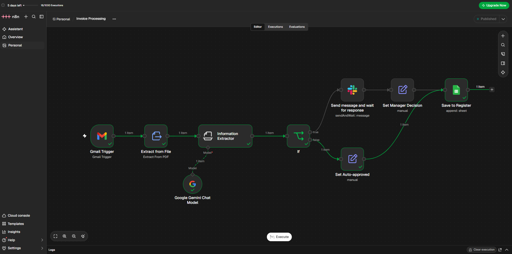

# n8n for Analysts

This repo has the workflow files from my YouTube series **n8n for Analysts**, where I build practical automations for real data and business work: reporting, data cleaning, internal tools and AI workflows. Each video solves a problem I've seen teams deal with every day.

▶️ **YouTube playlist:** [n8n for Analysts](https://youtube.com/playlist?list=PLBLnpl79rWi8&si=ozf1pB5E3uf7jMJH)
💼 **LinkedIn:** [linkedin.com/in/jennagozali](https://www.linkedin.com/in/jennagozali)

## The series

| # | Video | What it automates | Files |
|---|-------|-------------------|-------|
| 1 | [Daily FX Rates Feed](https://youtu.be/UXFZFvYl9rk?si=RSIkbhNCR1rA7e28) | Saves the latest USD exchange rates to Google Sheets every morning | [01-fx-feed](./01-fx-feed) |
| 2 | [Daily KPI Report by Email](https://youtu.be/8idacZnWaAo?si=QWfHtzJxLbe0Tiq7) | Emails managers a formatted sales summary every weekday | [02-kpi-email](./02-kpi-email) |
| 3 | [Complaint Intake with Escalation](https://youtu.be/BiQmFAlyX4c?si=JYoAUs_kApyEr-us) | Logs customer complaints and alerts the team on urgent ones | [03-complaint-intake](./03-complaint-intake) |
| 4 | [AI Inbox Triage](https://youtu.be/gLLuvihQBC4) | Uses AI to sort and label support emails | [04-ai-inbox-triage](./04-ai-inbox-triage) |
| 5 | [Clean and Flag Claims Data](https://youtu.be/YmfDuf1VEg0) | Cleans messy claims data and flags suspicious claims | [05-claims-cleaning](./05-claims-cleaning) |
| 6 | [Internal API with Error Alerts](https://youtu.be/WNhj4KL55cU) | A secure claim-status API, plus Slack alerts when a workflow fails | [06-claim-status-api](./06-claim-status-api) |
| 7 | [AI Weekly Analytics Summary](https://youtu.be/_X9IF3_owcM) | Calculates weekly results and has AI write the summary email | [07-ai-weekly-summary](./07-ai-weekly-summary) |
| 8 | [AI Invoice Processing with Approval](https://youtu.be/gVLNtUH_wvs) | Reads invoice PDFs and sends large ones for manager approval in Slack | [08-invoice-processing](./08-invoice-processing) |

## How to use these workflows

1. Open the folder for the video you want and download the `.json` file.
2. In n8n, create a new workflow, click **⋯** at the top, then **Import → From File**, and choose the file.
3. Connect your own accounts (Google, Slack, etc.). Credentials are not included in these files.
4. Each folder's README explains the sample data and setup.

## Tools used

n8n · Google Sheets · Gmail · Slack · Google Gemini · JavaScript
